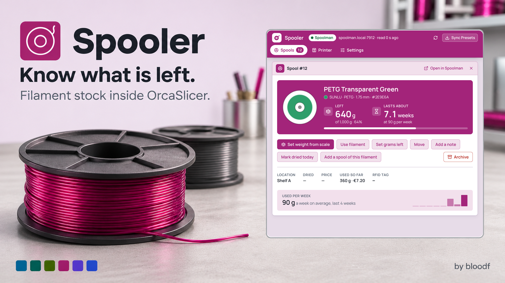
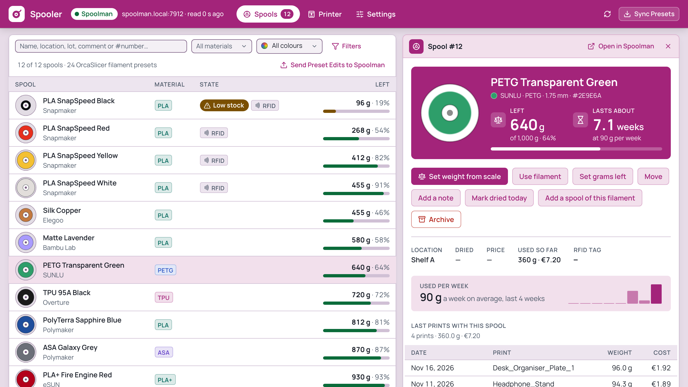
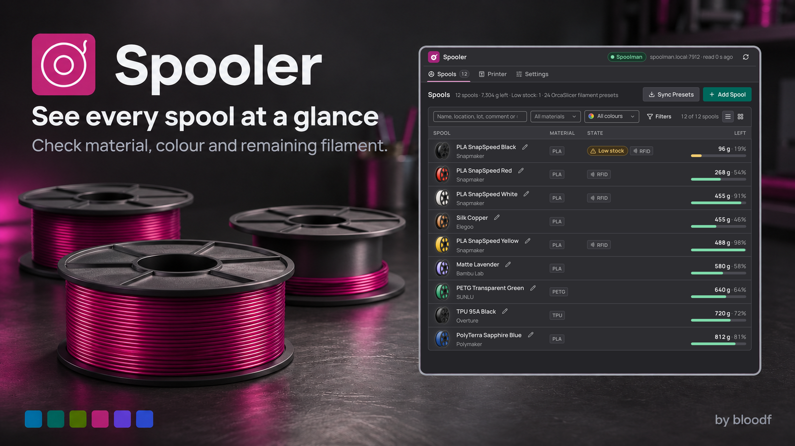
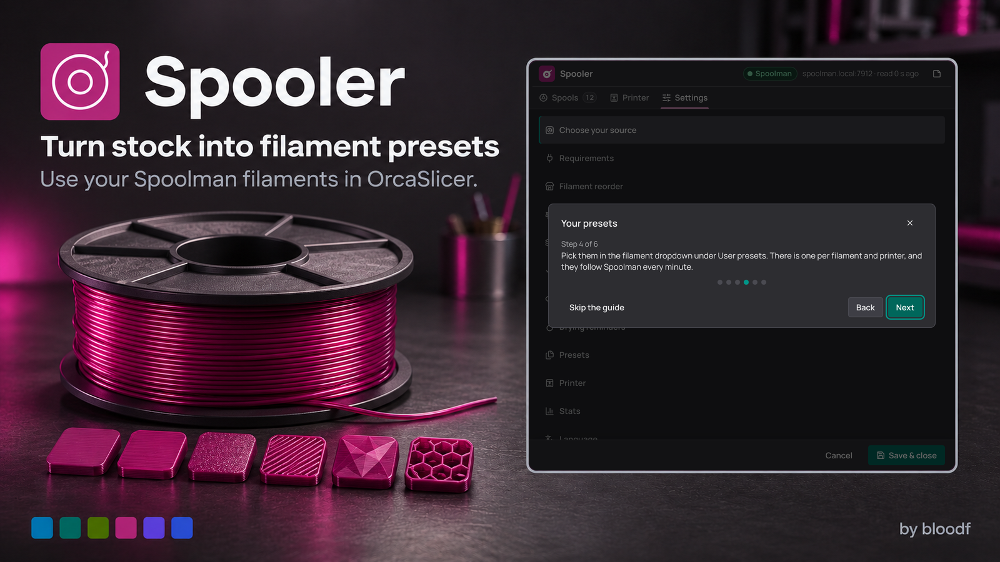
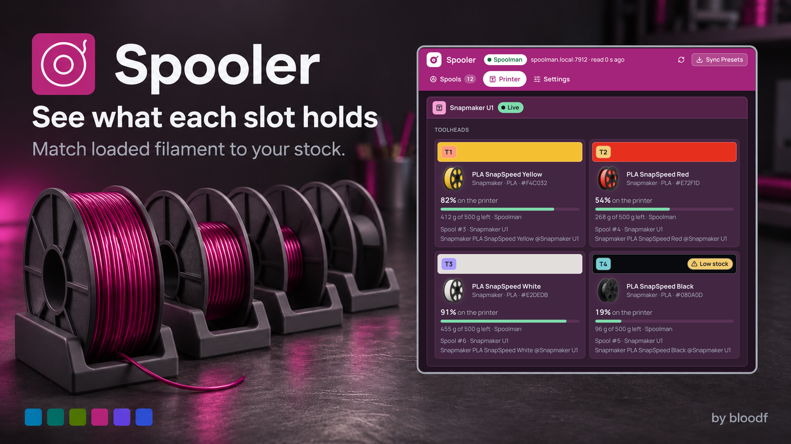
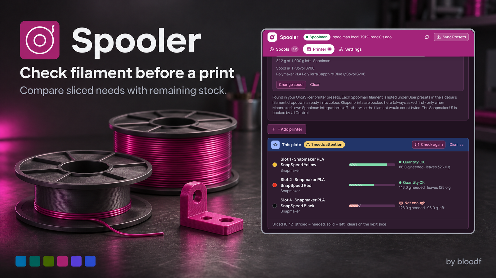
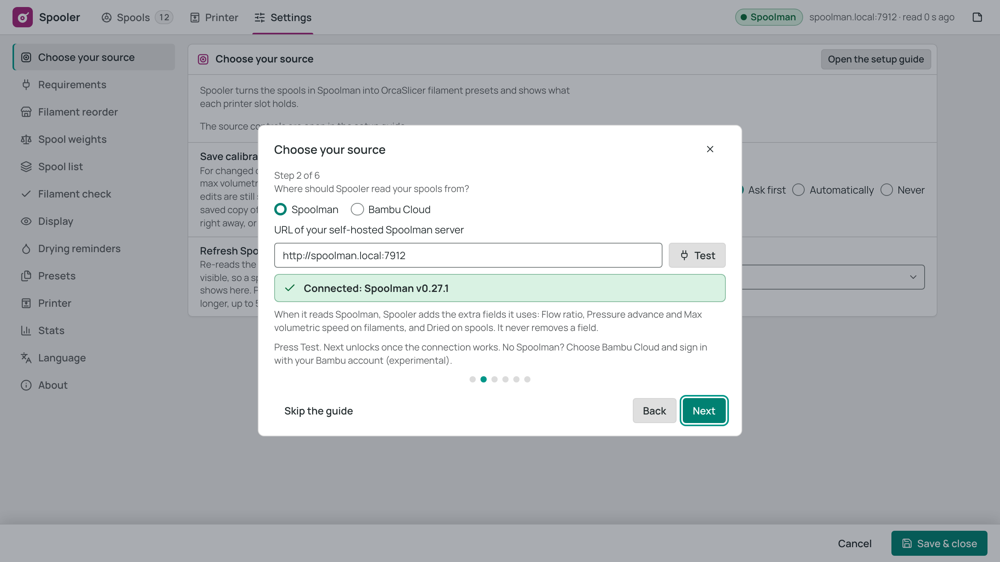

  <picture>
    <source media="(prefers-color-scheme: dark)" srcset="assets/readme/spooler-hero-dark-en.png">
    
  </picture>

<h1 align="center">🧵 Spooler</h1>

<b>Your Spoolman stock inside OrcaSlicer, with what is left on each spool.</b> An OrcaSlicer plugin · by bloodf

  
  
  
  

  <a href="#-install">Install</a> · <a href="#-features">Features</a> · <a href="#-how-to-use">How to use</a> · <a href="#-faq">FAQ</a> · <a href="README.pt-BR.md">Português</a>

## ✨ What it does

Spooler reads your spools from [Spoolman](https://github.com/Donkie/Spoolman) and lists them in a tab inside OrcaSlicer, each with its material, colour, location and grams left. Every filament with a spool in stock becomes an OrcaSlicer filament preset for each of your printers, already in its colour. The Printer tab shows which spool sits in each toolhead, lane or AMS slot, and after a slice Spooler compares what the plate needs with what is left.

  <picture>
    <source media="(prefers-color-scheme: dark)" srcset="assets/readme/spooler-screen-spools-dark-en.png">
    
  </picture>

## 📦 Install

Open [Spooler on Orca Cloud](https://cloud.orcaslicer.com/p/50c35dcbd6f3) and subscribe, then in OrcaSlicer open **File > Plugins**, click **Refresh** and tick **Activate**. Updates arrive the same way.

From a file:

1. Download `spooler_any.py` from the [latest release](https://github.com/bloodf/spooler/releases/latest). It is the same file on Windows, macOS and Linux.
2. Put it in its own folder called `spooler` inside OrcaSlicer's plugin directory, one Spooler file per folder: `%APPDATA%\OrcaSlicer\orca_plugins\` on Windows, `~/Library/Application Support/OrcaSlicer/orca_plugins/` on macOS, `~/.config/OrcaSlicer/orca_plugins/` on Linux.
3. Restart OrcaSlicer and tick **Activate** for Spooler. A **Spooler** tab appears in the top bar.

| Requirement | Detail |
|---|---|
| OrcaSlicer | 2.5.0 or later, for the plugin preset APIs |
| A spool source | A [Spoolman](https://github.com/Donkie/Spoolman) server you can reach, or a Bambu Cloud account (read-only, experimental) |
| Printers | Optional. Klipper/Moonraker, Snapmaker U1, Anycubic in LAN mode, Bambu Lab in LAN mode, PrusaLink and OctoPrint are read |
| System | Windows, macOS or Linux |

[docs/install.md](docs/install.md) shows each step with a picture.

Spooler is a fork of [Spoolio](https://github.com/danm1989/spoolio-orcaslicer) by Dan J Moore that adds a setup guide. It is an independent project, not affiliated with or endorsed by Spoolman, OrcaSlicer, Snapmaker, Sovol, Anycubic or Bambu Lab.

## 🧰 Features

<table>
  <tr>
    <td width="50%" valign="top">
      
      
<b>Every spool in one list</b> Material, colour, location and grams left, read from Spoolman and updated within a second or two.

    </td>
    <td width="50%" valign="top">
      
      
<b>Stock becomes filament presets</b> One preset per filament and printer under User presets, in the filament's colour and with its temperatures.

    </td>
  </tr>
  <tr>
    <td width="50%" valign="top">
      
      
<b>What each slot holds</b> Toolheads, lanes and AMS slots matched to your spools, with the preset each one gets.

    </td>
    <td width="50%" valign="top">
      
      
<b>A check after every slice</b> What the plate needs against what is left, with a notice that stays when a spool runs short.

    </td>
  </tr>
</table>

| | Feature | What you get |
|---|---|---|
| | Presets per printer | Each preset inherits the closest preset OrcaSlicer has for that printer and adds colour, vendor, nozzle and bed temperatures, density, diameter and cost from Spoolman. Example: `3D Procer PLA Pérola @Snapmaker U1`. |
| | Calibrated settings | A JSON `orca_settings` field on the Spoolman filament, per printer or `*` for all, plus **Flow ratio**, **Pressure advance** and **Max volumetric speed** fields on Spoolman's filament form. |
| | Edits go back | Change a Spooler preset in OrcaSlicer and it is sent to Spoolman after a few seconds, or at once with **Send Preset Edits to Spoolman**. |
| | Search and filters | Search matches name, location, lot number and comment, and `#12` finds spool 12. Material and colour filters, grouping, sorting, and **Closest colour**, which lists the 12 nearest spools. |
| | Spool actions | **Set weight from scale**, **Use filament**, **Set grams left**, **Add a note**, **Move**, **Mark dried today**, **Add a spool of this filament** (1 to 20), **Archive** and **Open in Spoolman**. |
| | Spool detail | What is left, how long it lasts, the prints that used the spool, grams and cost booked, and weekly use over the last 4 weeks. |
| | Low stock | A notification when a spool crosses your threshold (100 g by default), and a **Use first** chip on the oldest opened spool of a filament. |
| | Drying reminder | **Dried 12 d ago** on the spool, amber past the days set per material: PETG 30, TPU 14, PA 7, PVA 7, PC 14. |
| | Slots on the plate | **Plugins > Run > Spooler: Load Printer Filaments** puts each slot's preset on the plate. **Keep Slots Synced** keeps doing it when a spool changes. |
| | Usage booking | With Spoolman and a Bambu Live Link, the grams a print used are booked to the spool in each slot: **Ask me before booking**, **Book automatically** or **Don't track**. |
| | Stats | Usage, cost and print history, filament lost to supports, purging and failed prints, the value on the shelf, and **Export to CSV**. |
| | Works with U1 Control | Both plugins pick the same preset for a toolhead, and U1 Control books the filament used on the U1. |

The [user guide](docs/guide.md) has every setting, the supported `orca_settings` keys and the limits.

## 🛠️ How to use

1. Open the **Spooler** tab. On first run the setup guide opens over Settings.
2. Under **Choose your source**, enter your Spoolman address, for example `http://raspberrypi.local:7912`, and click **Test**. **Next** becomes available once it connects.
3. Allow the permission prompts. OrcaSlicer asks the first time Spooler reaches Spoolman or a printer and the first time it writes presets. Granting full access once avoids the repeats.
4. Click **Save & finish**. The **Spools** tab lists your stock.
5. In the sidebar's filament dropdown, pick a filament under **User presets**. The slot takes the filament's colour.
6. Open the **Printer** tab. Printers whose printer preset has a host address are already there. For a Bambu printer, click **+ Add printer** and **Live Link**.
7. Run **Plugins > Run > Spooler: Load Printer Filaments** to put what the printer holds on the plate.
8. To be warned before a print, switch on **Spooler Filament Check** in the process settings under **Others > Slicing Pipeline Plugin**. The result shows as a notification and in **This plate** on the Printer tab.

  <picture>
    <source media="(prefers-color-scheme: dark)" srcset="assets/readme/spooler-screen-setup-dark-en.png">
    
  </picture>

How each printer is read:

| Printer | What Spooler shows | Set up |
|---|---|---|
| Snapmaker U1 | Four toolheads, matched by spool id, else RFID tag, else vendor, material and colour | Host address in the printer preset |
| Klipper with AFC, Happy Hare or another tool that writes `lane_data` | Every lane, matched by spool id, else vendor, material and colour | Host address in the printer preset |
| Single-extruder Klipper, for example Sovol SV06 | Moonraker's active spool, with **Change spool** and **Clear** | Host address in the printer preset |
| Anycubic Kobra X and other Anycubic printers | ACE slots and the external spool, matched by material and colour | LAN mode on, IP address in the printer preset's host field |
| Bambu Lab | AMS slots and the external spool as the printer reports them | **Live Link** with IP address and access code, LAN mode on |
| PrusaLink, OctoPrint | Print progress; toolheads assigned by hand | **Live Link** with the printer's password or an application key |

## 🔒 Privacy and safety

Spooler has no telemetry and no account. It talks to the servers you point it at, and OrcaSlicer asks before it reaches a new address.

| Where | What Spooler reads | What Spooler writes |
|---|---|---|
| Your Spoolman server | Spools, filaments, locations and the server version | The extra fields it needs (`orca_settings`, `dried` and the three calibration fields; it never deletes one), preset edits you send, spool actions you take, and booked grams |
| Your printers, on the local network | Status reports over Moonraker, Anycubic LAN mode and Bambu Live Link | Only Moonraker's active spool, when you use **Change spool** or **Clear** |
| Bambu Cloud, if you choose it | Your filament library | Nothing. The sign-in token is kept on your computer, never the password |
| GitHub | The latest release number, when checking for an update | Nothing |
| Your computer | OrcaSlicer's presets and the sliced plate's filament use | Its presets in OrcaSlicer's user folder, and settings, log, history and CSV exports in `<OrcaSlicer data folder>/spooler/` |

Printer access codes stay in that folder and go nowhere but the printer. The links to Bambu and Anycubic printers don't verify the printer's certificate, since the printers use self-signed ones, so they trust your local network. The reorder cart opens a web search for the filament in your browser, only when you click it. Spooler downloads no code and starts no programs. [SECURITY.md](SECURITY.md) has the full list and how to report a problem.

## ❓ FAQ

Does it work without Spoolman?

Yes, with Bambu Cloud as the source. It is read-only and uses Bambu's unofficial service, so there are no spool actions and no usage booking, and the sign-in expires from time to time.

Why did the slot colours not change after Load Printer Filaments?

OrcaSlicer gives plugins no way to change a slot's colour, so the action sets the right presets and leaves the colours as they were. Pick the filament in the slot's dropdown, or use OrcaSlicer's own Sync filaments, to set the colour.

I pressed Save on a Spooler preset. Why did it stop following Spoolman?

OrcaSlicer can't save over a preset a plugin owns, so Save makes a separate copy. Spooler sends that copy's changed calibration settings to Spoolman, and the Spooler preset has them after its next rebuild. To change a preset and keep it following Spoolman, edit it and use <b>Send Preset Edits to Spoolman</b>.

Send Preset Edits to Spoolman says there are no unsaved changes. What now?

It sends the unsaved edits of the Spooler preset that is open in OrcaSlicer's filament settings, so open that preset and change a value first, without saving. Colour, vendor, material and name are changed in Spoolman. If it still refuses, add your log to <a href="https://github.com/bloodf/spooler/issues/38">issue 38</a>.

Why does the list not update live behind my reverse proxy?

Live updates use Spoolman's WebSocket at <code>/api/v1/spool</code>. The proxy must pass the <code>Upgrade</code> and <code>Connection</code> headers; in nginx, <code>proxy_set_header Upgrade $http_upgrade; proxy_set_header Connection "upgrade";</code>. Without it the list still refreshes every 60 seconds.

Which prints does Spooler book to Spoolman?

Bambu prints over Live Link. Klipper, PrusaLink and OctoPrint prints are always asked first, and Klipper only when Moonraker's own Spoolman integration is off, so nothing counts twice. The Snapmaker U1 is booked by U1 Control. Anycubic prints are not booked yet; <a href="docs/kobra-booking.md">docs/kobra-booking.md</a> says what is missing.

Why are Stats and the spool history empty after installing?

They are built from what Spooler booked, so they start empty and fill as prints are booked.

Why do I see a Spooler tab and a U1 Control tab?

Each plugin has its own tab. U1 Control runs the Snapmaker U1 and links spools to its toolheads; Spooler shows your whole stock and what it reads from every printer.

## 🌍 Languages

English, Brazilian Portuguese, Spanish, German and Simplified Chinese. The page follows OrcaSlicer's language, and Settings > **Language** changes it.

## 🧩 More plugins by bloodf

| | Plugin | What it does | |
|:-:|---|---|---|
|  | 🧩 [Organizer](https://github.com/bloodf/orca_organizer) | Arrange parts by their real outline and fill a plate with more copies. | [Install](https://cloud.orcaslicer.com/p/5bf381fd42d4) |
|  | 🧲 [Embedder](https://github.com/bloodf/embedder) | Magnet and NFC pockets, with the pause at the right layer. | [Install](https://cloud.orcaslicer.com/p/58222d4f9e52) |
|  | 💰 [Print Calculator](https://github.com/bloodf/orca_print_calculator) | Price every plate: filament, energy, labour, fees and margin. | [Install](https://cloud.orcaslicer.com/p/521c07cf6de2) |
|  | 🧵 **Spooler** · you are here | Your Spoolman stock inside OrcaSlicer, with what is left on each spool. | |
|  | 🟣 [Kobra Control](https://github.com/bloodf/kobracontrol) | Run the Anycubic Kobra X from OrcaSlicer over your LAN. | [Install](https://cloud.orcaslicer.com/p/59c786285255) |
|  | 🔵 [U1 Control](https://github.com/bloodf/u1control) | Run the Snapmaker U1 from OrcaSlicer: toolheads, camera, files. | [Install](https://cloud.orcaslicer.com/p/55b8c347d443) |

Each plugin works on its own; installed together they share data where it helps.

## 🤝 Contributing

Bug reports, printer data and pull requests are welcome: [report a bug](https://github.com/bloodf/spooler/issues/new?template=bug_report.yml) or [request a feature](https://github.com/bloodf/spooler/issues/new?template=feature_request.yml). [CONTRIBUTING.md](CONTRIBUTING.md) covers the setup, the tests and the build, [docs/](docs/) has a [tour of the code](docs/how-it-works.md) and the [release notes for maintainers](docs/release.md), and [NOTICE.md](NOTICE.md) lists the credits. Everyone taking part follows the [code of conduct](CODE_OF_CONDUCT.md).

## 📄 License

MIT. See [LICENSE](LICENSE).

by bloodf

