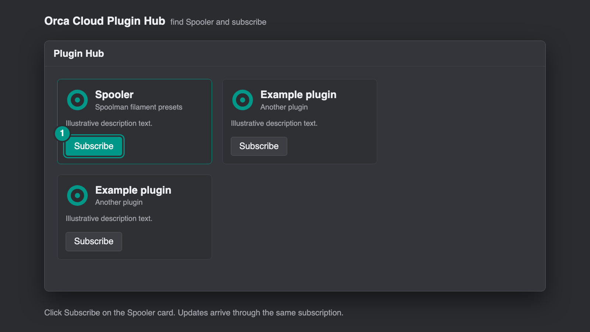
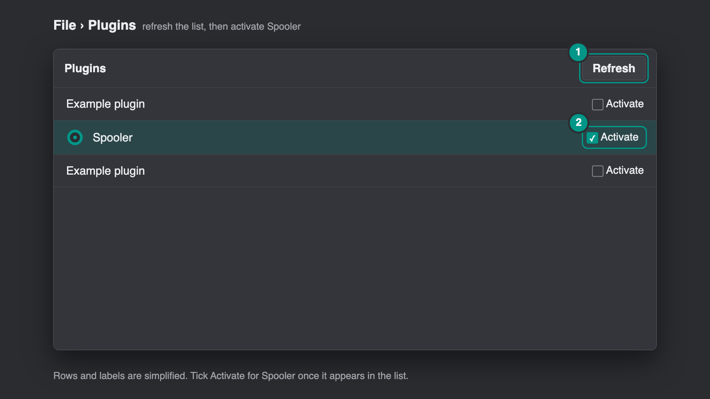
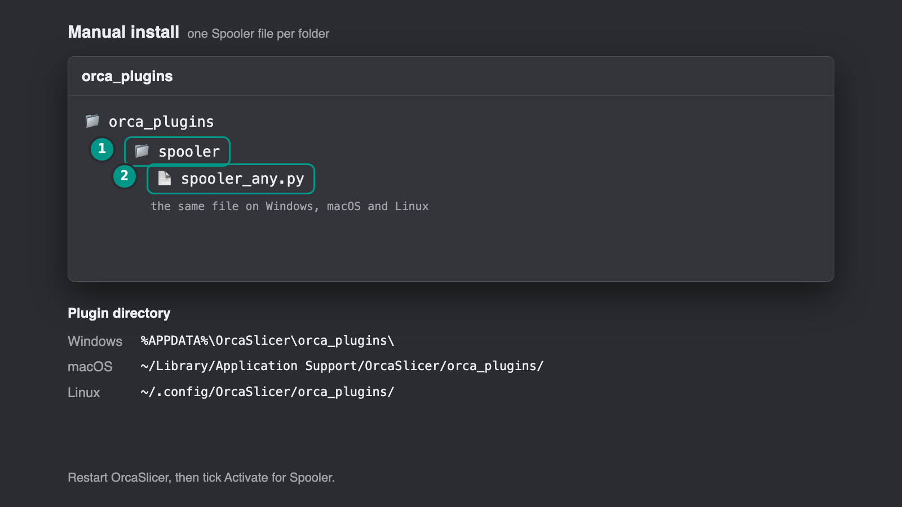
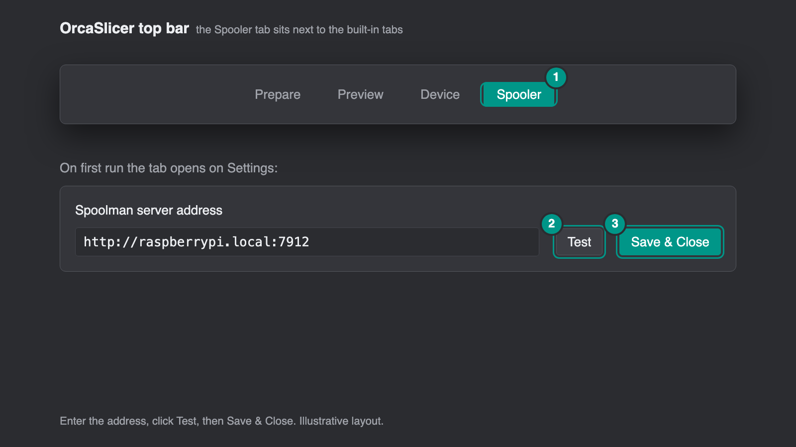
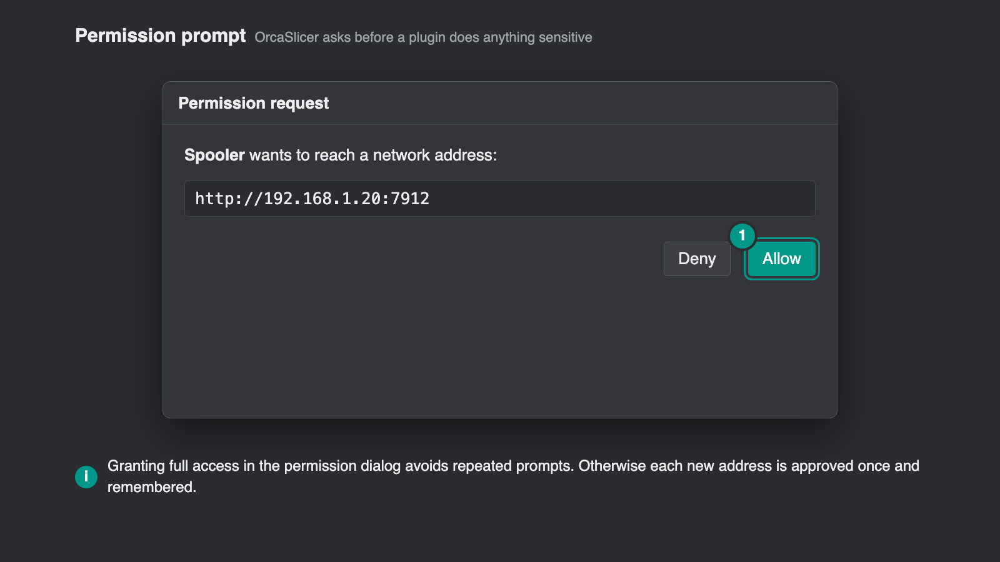

<p align="center">
  
</p>

# Spooler for OrcaSlicer

<p align="center">
  <a href="https://github.com/bloodf/spooler/actions/workflows/ci.yml"></a>
  <a href="https://github.com/bloodf/spooler/releases/latest"></a>
  <a href="LICENSE"></a>
</p>

Spooler is a fork of [Spoolio](https://github.com/danm1989/spoolio-orcaslicer) by Dan J Moore that
does the setup for you. Enter your [Spoolman](https://github.com/Donkie/Spoolman) address once;
the rest is automatic.

## What the fork adds

- **Notices that help you choose a spool.** A low-stock notification in OrcaSlicer when a spool
  crosses your threshold (once per crossing, none at start-up). The after-slice notice adds what the
  print costs in filament when prices are in Spoolman, and when a slot is short it suggests an
  unloaded spool of the same filament with enough left and where it is. Opened spools of a filament
  with several spools get a ***Use First*** chip on the oldest, to finish it first. Chip and
  notification each switch off in Settings > Display. The swap suggestion only knows spools loaded in
  your saved printers or reported live by them.
- **A drying tracker and reminder.** ***Mark Dried Today*** in a spool's menu stores the date in
  a Spoolman field (added on demand) and the card shows ***Dried 12 d ago***, amber once it is past
  the days set for that material in Settings > Drying Reminders (PETG 30, TPU 14, PA 7, PVA 7, PC 14
  by default; PLA, ABS and ASA off). The after-slice notice mentions a loaded spool of such a
  material that was dried too long ago or never. Spoolman only, and the notice checks the fullest
  matching spool of each slot.
- **More from your spool data.** ***Details*** in a spool's menu lists the prints that used it, the
  grams and cost booked, the weekly use over the last 4 weeks and the weeks left at that rate. The
  Stats tab adds ***On the Shelf*** (grams and money in stock, by material too; spools without a
  price count as grams only), ***Lost to Failed Prints*** and an ***Export to CSV*** button on Print
  History, which saves the selected period to an `exports` folder next to Spooler's settings and
  opens it. Filters has a ***Closest colour*** picker that lists the 12 nearest spools. Details,
  stock value and failed-print totals come from what Spooler booked, so they start empty on a new
  install.
- **A setup guide for first use.** The first time you open Settings, a short step-by-step guide
  explains what Spooler does, takes your Spoolman address and tests it right there, and covers
  permissions, where the presets appear and how printers are found. Skip it any time, and reopen
  it from ***Open the setup guide*** in Settings.
- **Your Spoolman filaments become OrcaSlicer filament presets, one per printer.** For each of your
  printers, every Spoolman filament with a spool in stock shows up under ***User presets*** in the
  sidebar's filament dropdown, for example `3D Procer PLA Pérola @Snapmaker U1` and
  `3D Procer PLA Pérola @Sovol SV06`. Pick it for a slot and OrcaSlicer sets the slot to the
  filament's colour. No more editing colours or cloning profiles.
  - Each preset inherits the closest preset OrcaSlicer already has **for that printer**, so the
    printer's own tuning is kept: Snapmaker SnapSpeed spools on the U1 get
    `Snapmaker PLA SnapSpeed @U1`, other PLA gets `Generic PLA @U1 0.4 nozzle`, silk gets the silk
    preset, and so on. The vendor's own preset wins when OrcaSlicer has one.
  - On top of that it carries the filament's colour, vendor, nozzle and bed temperatures (the bed
    temperature on every plate type), density, diameter and cost from Spoolman.
  - Calibrated settings come along too: add a text extra field `orca_settings` to filaments in
    Spoolman (Settings > Extra Fields) and put a JSON object of OrcaSlicer filament settings in it,
    either for every printer or in sections named after part of a printer preset's name, `*` for
    all:
    `{"*": {"filament_flow_ratio": "0.98"}, "Snapmaker U1": {"filament_max_volumetric_speed": 20}}`.
    Supported: flow ratio, max volumetric speed, pressure advance, retraction length and speeds,
    Z hop, ironing flow, speed, spacing and inset, nozzle and plate temperatures, fan speeds,
    slow-down settings, shrinkage (also in Z), softening temperature, density, diameter, cost and
    notes. Other keys are ignored, and so is text that isn't one number (say `"0,95"`) for a number
    setting.
  - Spooler adds three number fields to Spoolman's filament form, ***Flow ratio***,
    ***Pressure advance*** and ***Max volumetric speed***, for the values people calibrate most.
    They apply to every printer; a value in `orca_settings` wins over them.
  - The presets follow Spoolman: new filaments appear, filaments whose spools are all archived
    disappear, and changes are picked up on each refresh (every 60 seconds while the Spooler tab
    is open). ***Sync Presets*** on the Spools tab does it at once and rebuilds every preset, even
    when nothing changed.
  - "Your printers" are the printers behind every printer preset with a host address
    (Printer settings > Connection), plus the printer currently selected.
- **Change a preset in OrcaSlicer and it reaches Spoolman.** Edit a Spooler preset in OrcaSlicer's
  filament settings and leave it a few seconds: while the Spooler tab is open the change is sent
  to Spoolman by itself (or press ***Send to Spoolman*** on the Spools tab; never Save, which makes
  a copy that stops following Spoolman). Density, diameter and cost go to Spoolman's own fields;
  the other settings go into the filament's `orca_settings` field, in the section for that preset's
  printer (the field is created when Spoolman doesn't have it). The presets are then rebuilt, so
  the preset keeps your change and shows no unsaved changes. A setting changed in Spoolman
  meanwhile keeps Spoolman's value and stays unsaved in OrcaSlicer, for you to send again or
  discard. Colour, vendor, material and name are changed in Spoolman. To send only by hand, set
  `"auto_send": false` in Spooler's settings file.
- **Spool list:** spools of the same filament (vendor, name and colour) fold into one row with
  their total; click it to see each spool. The name filter and a colour filter, which picks a
  colour family from swatches, sit above the list.
- **Act on a spool from its card (Spoolman).** The ***⋯*** button on each spool card opens its
  actions: ***Set Weight From Scale*** (weigh the spool and enter the gross weight), ***Use
  Filament*** (subtract grams by hand), ***Move*** (pick one of Spoolman's locations or type a new
  one), ***Archive*** / ***Unarchive***, ***Add Spool of This Filament*** and ***Open in
  Spoolman***. Archiving and adding ask for a second click; so does moving a spool off a U1
  toolhead's location, since that unlinks it in u1control. ***Show archived*** in the filters
  lists archived spools, dimmed; they still never count for presets, the filament check or the
  printer slots.
- **The list follows Spoolman live.** A spool added, changed, used or deleted in Spoolman shows on
  the Spools tab within a second or two, over Spoolman's WebSocket; the 60 second refresh stays as
  the fallback.
- **Comment, lot number and extra fields on the card.** Each spool card can show its Spoolman
  comment, lot number and your own extra fields on a muted line (hover for the full text). Search
  also matches location, lot number and comment, and `#12` finds spool 12.
- **You choose what's shown.** Settings > Display switches each part of the spool list and of the
  printer slots on or off; printer slots can show the loaded spool in full (manufacturer, grams
  left, spool number, location, preset).
- **Save a copy, keep the change.** OrcaSlicer's Save on a Spooler preset makes a separate copy;
  Spooler sends that copy's changed calibration settings to Spoolman, so the Spooler preset has
  them after its next rebuild.
- **Settings in OrcaSlicer's plugin manager** too (Plugins > Spooler > Config), with Restore defaults.
- **Works with u1control on the Snapmaker U1.** With [u1control](https://github.com/bloodf/u1control)
  installed, the Printer tab uses the spool u1control bound to each toolhead (on stock firmware it
  is the spool's Spoolman location, `Snapmaker U1 T1` and so on). Spooler publishes its preset names
  in `<OrcaSlicer data folder>/spooler/profiles.json` so both pick the same preset, and while Keep
  Slots Synced runs u1control leaves the plate's slots to it. Filament use on the U1 is booked by
  u1control, not Spooler. The binding is found when u1control's printer name is Spooler's printer
  label or model, or ends in "U1" (the default "Snapmaker U1", or e.g. "Workshop U1"); with two U1s
  name them apart in u1control.
- **Klipper/Moonraker printers are found for you.** Any printer preset with a host address appears
  in the ***Printer*** tab with no further setup:
  - **Snapmaker U1:** all four toolheads, matched to your Spoolman spools by the spool id the
    printer reports, else by RFID tag, else by vendor, material and colour.
  - **Klipper printers with a filament changer run by AFC, Happy Hare or another tool that writes
    Moonraker's `lane_data` (e.g. Elegoo Centauri Carbon with CANVAS on OpenCentauri):** every lane,
    matched to your Spoolman spools by the spool id the lane reports, else by vendor, material and
    colour.
  - **Single-extruder Klipper printers (e.g. Sovol SV06 with Klipper):** the spool Moonraker's
    Spoolman integration has marked as active. ***Change Spool*** on the card picks another
    non-archived spool and ***Clear*** unsets it, so Moonraker books the next print to the right
    spool. Not offered on the U1 or on filament changers, which manage their own spools.
  - **Anycubic Kobra X (and other Anycubic printers in LAN mode):** each slot of the multi-colour
    box (ACE) and the external spool, matched to your Spoolman spools by material and colour.
    Turn on LAN mode on the printer and put its IP address in the printer preset's host field.
  Hover a slot to see which OrcaSlicer preset matches it. Hosts that aren't Moonraker are ignored.
- **Plugins > Run > "Spooler: Load Printer Filaments"** puts the preset for the filament each
  toolhead or lane holds into the plate's filament slots, for the printer currently selected.
- **Plugins > Run > "Spooler: Keep Slots Synced"** does the same and keeps doing it. When it
  starts, and whenever a lane's spool changes, the lane's slot gets the Spooler preset. A slot that
  gets a system preset (OrcaSlicer's own Sync filaments assigns those) gets the Spooler preset back;
  one of your own presets stays until the lane's spool changes. Each change goes through
  OrcaSlicer's normal preset selection, so it can ask about unsaved changes in the filament
  settings. Run it once per OrcaSlicer session; run it again to stop it.

- **Stats, with the filament you waste.** The Stats tab (from Spoolio) shows usage, cost and print
  history, and estimates how much of each print went into supports and into purging and the prime
  tower: a Wasted Filament tile, a Usage Ratios card with the three most wasteful prints, and a
  Waste column in Print History. The estimate is read from the plate G-code in the job file on the
  printer, so it covers Bambu prints booked after updating to 0.13.0.

Everything Spoolio already did is still there: spool cards, the Bambu Cloud source, Bambu Live
Link, filament usage booking, the Stats tab and the after-slice filament check.

### Limits

- Needs a current OrcaSlicer with the plugin preset APIs
  (`orca.host.preset.bundles.reload_local` and `orca.host.preset.filament.begin_update`);
  tested against OrcaSlicer 2.5.0.
- OrcaSlicer only lets a plugin assign presets to the plate's slots from a ***Plugins > Run***
  action, and gives plugins no way to change a slot's colour. "Load Printer Filaments" and "Keep
  Slots Synced" therefore set the right presets but leave the slot colours as they were; picking
  the filament in the slot's dropdown, or OrcaSlicer's own Sync filaments, sets the colour.
- Generated presets are owned by Spooler and are rewritten from Spoolman. OrcaSlicer can't save
  over them: Save makes a separate user preset that no longer follows Spoolman. Use ***Send to
  Spoolman*** instead.
- Card actions need Spoolman as the source; Bambu Cloud spools have none. Set Weight From Scale
  needs the spool's empty weight (or the filament's) in Spoolman.
- Live list updates need Spoolman's WebSocket (`/api/v1/spool`) to be reachable from OrcaSlicer.
  Behind a reverse proxy, the proxy must pass the `Upgrade` and `Connection` headers (nginx:
  `proxy_set_header Upgrade $http_upgrade; proxy_set_header Connection "upgrade";`). Without it
  the list still refreshes every 60 seconds.
- Filament used by Anycubic prints is not booked to Spoolman yet: the printer's print-status
  messages must first be captured from a real print. See [docs/kobra-booking.md](docs/kobra-booking.md)
  if you have a Kobra and want to help.
- Filament usage on Klipper printers is best tracked by Moonraker's own
  [Spoolman integration](https://moonraker.readthedocs.io/en/latest/configuration/#spoolman).

## Images

<p align="center"></p>
<p align="center"></p>
<p align="center"></p>
<p align="center"></p>

Regenerate them after interface changes with `python scripts/store_images/render.py` (needs Google
Chrome or Chromium).

## Install

**From Orca Cloud:** open the [Plugin Hub](https://cloud.orcaslicer.com/app/plugins/plugin-hub), find
**Spooler** and subscribe, then in OrcaSlicer open ***File > Plugins***, click ***Refresh*** and tick
***Activate***. Updates arrive the same way.

<p align="center"></p>
<p align="center"></p>

**Manually:** download the file for your system from the [latest release](../../releases/latest):

| System | File |
|---|---|
| Windows (x86_64) | `spooler_win_x86_64.py` |
| Windows (arm64) | `spooler_win_arm64.py` |
| Linux (x86_64) | `spooler_linux_x86_64.py` |
| Linux (arm64) | `spooler_linux_arm64.py` |
| macOS (Apple silicon) | `spooler_macosx_arm64.py` |
| macOS (Intel) | `spooler_macosx_x86_64.py` |

Place it in its own folder called `spooler` inside OrcaSlicer's plugin directory (one Spooler file per folder):

| OS | Plugin directory |
|---|---|
| Windows | `%APPDATA%\OrcaSlicer\orca_plugins\` |
| macOS | `~/Library/Application Support/OrcaSlicer/orca_plugins/` |
| Linux | `~/.config/OrcaSlicer/orca_plugins/` |

<p align="center"></p>

Restart OrcaSlicer, then tick ***Activate*** for Spooler. A **Spooler** tab appears in the top bar.

The install pictures are drawn illustrations, simplified, not screenshots.

## Set Up

The Spooler tab opens on its Settings page on first run, with a setup guide over it:

1. **What Spooler does.** Your Spoolman spools become OrcaSlicer filament presets, and your printers' slots are shown.
2. **Choose your source.** Enter your Spoolman server address (for example `http://raspberrypi.local:7912`) and click ***Test***. ***Next*** unlocks once the connection is confirmed.
3. **Permissions.** See below.
4. **Presets.** Where they appear, and that they follow Spoolman every minute.
5. **Printers.** How they are found, and what ***Plugins > Run > Spooler: Load Printer Filaments*** does.
6. **Done.** Optional extras, then ***Save & finish*** saves the settings and takes you to your spool list.

<p align="center"></p>

***Next*** and ***Back*** move between steps, ***Skip*** (or Escape) closes the guide, and ***Open the setup guide*** in Settings brings it back. The guide appears by itself only when no source is set up yet, so it never shows for an existing setup. You can also set the low-stock threshold, the cart button and how weights are shown on the Settings page, and reopen the page any time with the ***Settings*** button.

Prefer Bambu Cloud? Choose ***Bambu Cloud*** under ***Choose Your Source***, enter your Bambu email and password, pick Global or China, and enter the verification code if Bambu asks for one. Spooler never stores your password, only the sign-in token Bambu returns, and ***Sign Out*** removes it.

OrcaSlicer asks before a plugin does anything sensitive. Granting Spooler full access in the permission dialog avoids repeated prompts; otherwise each new address it reads (Spoolman and each printer) is approved once and remembered. Expect a prompt the first time the plugin connects to Spoolman, Bambu Cloud or a printer, the first time it writes the filament presets into OrcaSlicer's user folder, and the first time you click a reorder cart to open your browser.

<p align="center"></p>

> [!TIP]
> ### Printer Tab
> The **Printer** tab sits beside **Spools** and shows a card for each of your printers. Click ***+ Add Printer***, then add an AMS or an external spool, you can create it to match your setup, and use ***+ Assign Spool*** to choose which of your spools is in each slot. This is stored in Spooler only and nothing is changed in Spoolman or Bambu Cloud. With Bambu Cloud, spools your library has linked to a slot also show, but that can lag behind what is physically loaded.
>
> ### Live Link
> To read a printer directly, press ***Live Link*** on its card and enter its IP address, its serial number (optional, Spooler reads it from the printer's certificate when left blank) and its access code, all found in the printer's network settings with LAN mode on. The slots then show what the printer reports and how long ago it was updated. Spooler keeps the access code in a private file on your computer and only reads from the printer. Removing a printer also removes its Live Link.

> [!TIP]
> ### Filament Usage Booking
> With Spoolman as your source and a Live Link on the printer, Spooler can book the filament a print used. When a print finishes, it works out which spool was in each slot from the RFID tag, matching it to your Spoolman spools by the `tag` extra field on the spool (or the long serial Bambu uses for RFID detection), and books the grams from the sliced G-code to that spool. Under ***When a Print Finishes*** choose ***Ask Me Before Booking***, ***Book Automatically*** or ***Do Not Track***.
>
> Slots whose spool can't be identified, and prints that were cancelled (where the grams are estimated from the progress), always have to be booked manually, and nothing is booked twice. Bambu Cloud has no booking, as there is no way to write to its filament library.

> [!IMPORTANT]
> ### Bambu Cloud Limitations
> - **Unofficial and experimental.** This uses Bambu's unofficial cloud service, which Bambu can change without notice. If it stops working, sign out and back in, if that still fails then please report it.
>     - **Sign-in expires.** Spooler keeps only the sign-in token, not your password, so when Bambu expires the token you'll be asked to sign in again from Settings.
> - Spooler can only ***read*** your Bambu filament library but cannot write to it, so nothing you do in Spooler changes your Bambu spools.
> - Filament usage booking is ***<ins>only</ins>*** available with Spoolman. Spooler has no way to write used weight back to the Bambu library, and I haven't verified whether being logged into Bambu Cloud tracks remaining weight itself for RFID spools.
> - There is no live AMS through the cloud. A printer in LAN mode isn't bound to your account, so Bambu Cloud doesn't list it and sends no AMS data. Use ***Live Link*** (works with either source) for live slots, or assign spools by hand.
> - The spools your library has linked to a slot are a representative view only and can differ from what is physically loaded.
> - The Printer tab setup is local. Printers, AMS units and slot assignments you set up are stored in Spooler on your computer, not in your Bambu account.
>
> ### Live Link and Booking Limitations
> - Live Link needs the printer on the same network with LAN mode on, and only connects while the Printer tab is open or usage booking is on.
> - The Stats tab's wasted-filament estimate needs the job file from a Bambu printer, so it only covers prints booked that way, made after updating to 0.13.0.
> - Booking assumes the slicer's filament slots follow the order of the printer's slots (AMS 1 slots 1 to 4, then the next AMS, and so on), so check the first few bookings if you use a different mapping.

> [!TIP]
> ### Filament Check 
> After each slice, Spooler compares the filament the plate needs with what is left on your spools. You get a short-lived notification when there is enough, and one that stays until you dismiss it when there may not be enough filament loaded.
>
> To use it, switch on ***Spooler Filament Check*** in your process settings, under ***Others > Slicing Pipeline Plugin***. The results also appear in a **This Plate** panel on the Printer tab, where **Re-check** runs it again with fresh data and **Dismiss** hides it until the next slice. You can hide the notifications and the panel, or change the safety margin (10% by default), on the Settings page.
>
> - Each filament the plate uses is matched to spools in Spoolman by vendor, material and colour. Slots that hold the same filament are treated as one supply, because the AMS moves on to the next spool of the same filament when one runs out: their use is added together and compared with the spools' combined weight. Spare spools that aren't loaded never count towards it.
> - If a matching spool is too low to cover print on the plate, and you have another spool available to the one that is loaded, you get a warning to make sure the right spool is loaded. Archive finished spools in Spoolman so they aren't counted.
> - If no spool matches, or Spoolman can't be reached, you get a short note and nothing else.
> - Slicer figures are estimates and real use can differ a little, so the safety margin gives you headroom.

## Feedback

Encounter a problem or have an idea? Please
[report a bug](../../issues/new?template=bug_report.yml) or
[request a new feature](../../issues/new?template=feature_request.yml).

## Acknowledgements

- [**Spoolio**](https://github.com/danm1989/spoolio-orcaslicer) by Dan J Moore, which this fork is
  built on, including its interface.
- [**Spoolman**](https://github.com/Donkie/Spoolman) by Donkie and contributors.
- [**OrcaSlicer**](https://github.com/OrcaSlicer/OrcaSlicer) by SoftFever and contributors.
- [**q2-offload**](https://github.com/cedbossneo/q2-offload), whose plugin showed the local preset
  bundle approach.

This is an independent project and is not affiliated with or endorsed by Spoolman, OrcaSlicer,
Snapmaker, Sovol, Anycubic or Bambu Lab.

## Contributing

Bug reports, printer data and pull requests are welcome. [CONTRIBUTING.md](CONTRIBUTING.md) covers
the setup, the tests and how to try a build in OrcaSlicer, and
[docs/how-it-works.md](docs/how-it-works.md) is a tour of the code.

```sh
python -m unittest discover -s tests   # unit tests, with a stand-in for OrcaSlicer's orca module
ruff check plugin scripts tests        # lint
python scripts/build.py                # per-OS plugin files and an all-OS wheel in dist/
```

Please report security problems privately, as [SECURITY.md](SECURITY.md) explains. Everyone taking
part follows the [code of conduct](CODE_OF_CONDUCT.md).

## License

MIT - see [LICENSE](LICENSE).
