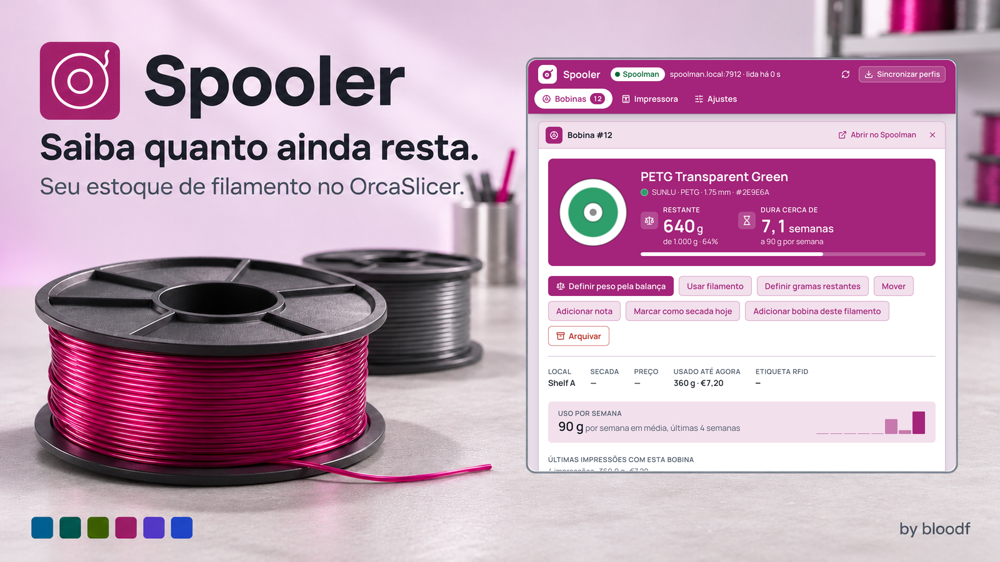
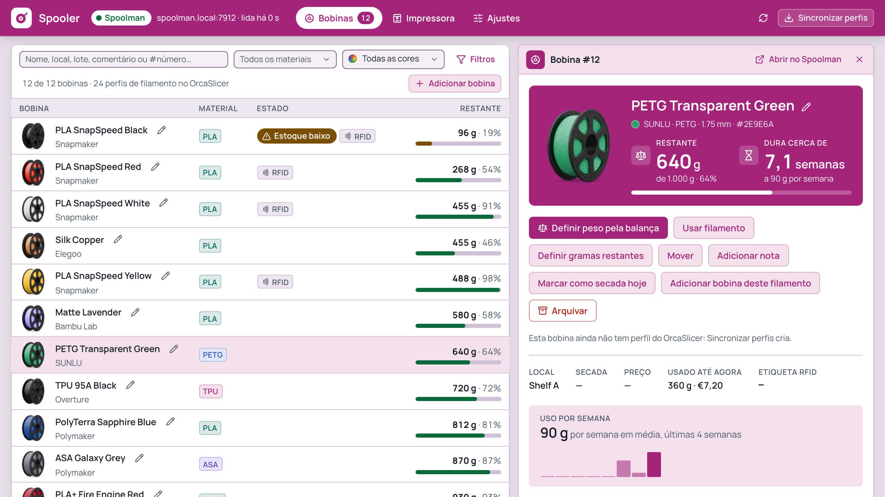
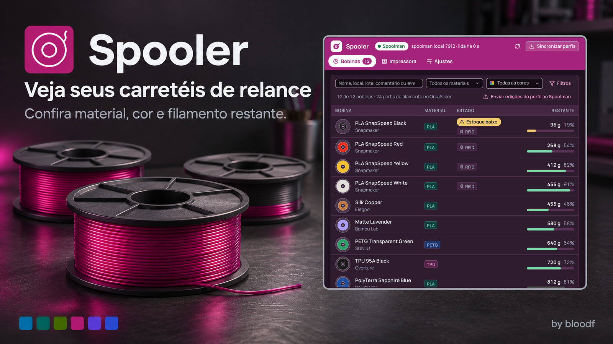
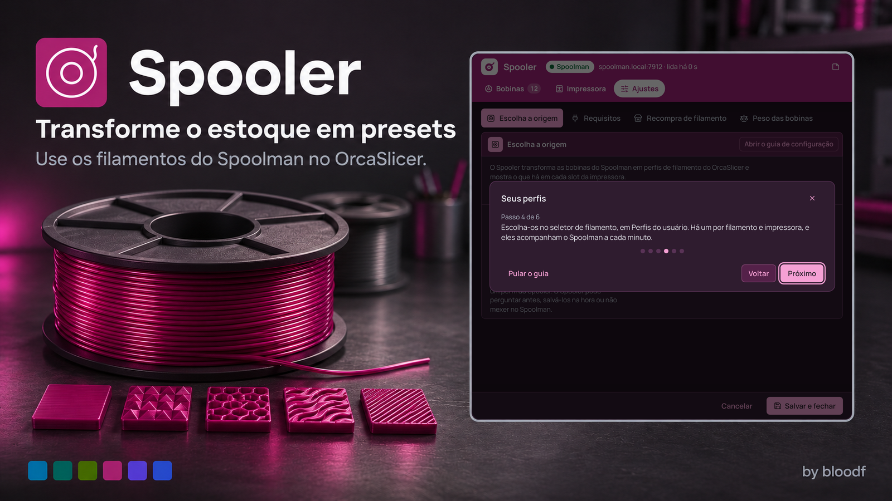
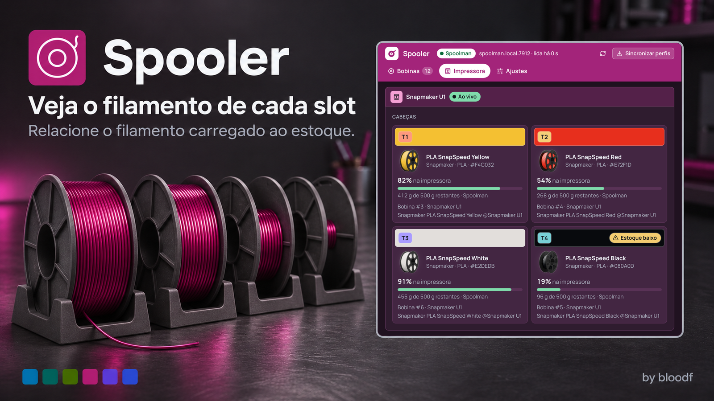
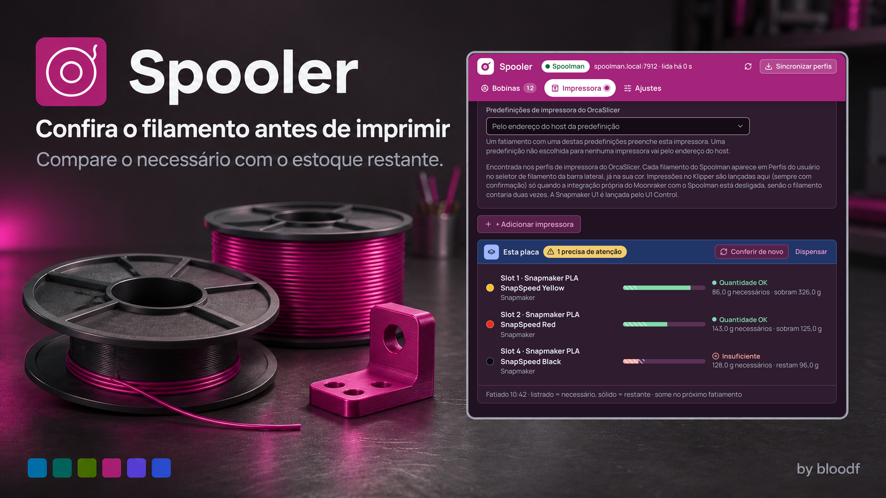
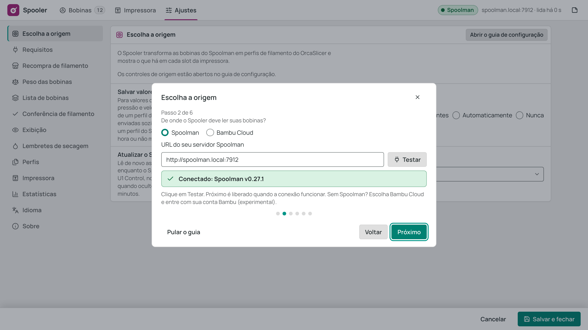

  <picture>
    <source media="(prefers-color-scheme: dark)" srcset="assets/readme/spooler-hero-dark-pt-BR.png">
    
  </picture>

<h1 align="center">🧵 Spooler</h1>

<b>Seu estoque do Spoolman dentro do OrcaSlicer, com o que resta em cada bobina.</b> Um plugin do OrcaSlicer · by bloodf

  
  
  
  

  <a href="#-instalação">Instalação</a> · <a href="#-recursos">Recursos</a> · <a href="#-como-usar">Como usar</a> · <a href="#-perguntas-frequentes">Perguntas</a> · <a href="README.md">English</a>

## ✨ O que faz

O Spooler lê suas bobinas do [Spoolman](https://github.com/Donkie/Spoolman) e as lista em uma aba dentro do OrcaSlicer, cada uma com material, cor, local e gramas restantes. Todo filamento com bobina em estoque vira um perfil de filamento do OrcaSlicer para cada uma das suas impressoras, já na cor certa. A aba Impressora mostra qual bobina está em cada cabeça, trilha ou slot do AMS, e depois de fatiar o Spooler compara o que a mesa precisa com o que resta.

  <picture>
    <source media="(prefers-color-scheme: dark)" srcset="assets/readme/spooler-screen-spools-dark-pt-BR.png">
    
  </picture>

## 📦 Instalação

Abra o [Spooler no Orca Cloud](https://cloud.orcaslicer.com/p/50c35dcbd6f3) e assine. Depois, no OrcaSlicer, abra **File > Plugins**, clique em **Refresh** e marque **Activate**. As atualizações chegam do mesmo jeito.

Por arquivo:

1. Baixe `spooler_any.py` da [última versão](https://github.com/bloodf/spooler/releases/latest). É o mesmo arquivo no Windows, no macOS e no Linux.
2. Coloque-o em uma pasta própria chamada `spooler` dentro do diretório de plugins do OrcaSlicer, um arquivo do Spooler por pasta: `%APPDATA%\OrcaSlicer\orca_plugins\` no Windows, `~/Library/Application Support/OrcaSlicer/orca_plugins/` no macOS, `~/.config/OrcaSlicer/orca_plugins/` no Linux.
3. Reinicie o OrcaSlicer e marque **Activate** no Spooler. Uma aba **Spooler** aparece na barra superior.

| Requisito | Detalhe |
|---|---|
| OrcaSlicer | 2.5.0 ou mais novo, pelas APIs de perfis para plugins |
| Uma origem de bobinas | Um servidor [Spoolman](https://github.com/Donkie/Spoolman) acessível, ou uma conta Bambu Cloud (só leitura, experimental) |
| Impressoras | Opcional. São lidas Klipper/Moonraker, Snapmaker U1, Anycubic em modo LAN, Bambu Lab em modo LAN, PrusaLink e OctoPrint |
| Sistema | Windows, macOS ou Linux |

[docs/install.md](docs/install.md) mostra cada passo com uma figura (em inglês).

O Spooler é um fork do [Spoolio](https://github.com/danm1989/spoolio-orcaslicer), de Dan J Moore, que acrescenta um guia de configuração. É um projeto independente, sem vínculo com Spoolman, OrcaSlicer, Snapmaker, Sovol, Anycubic ou Bambu Lab e sem o endosso deles.

## 🧰 Recursos

<table>
  <tr>
    <td width="50%" valign="top">
      
      
<b>Todas as bobinas em uma lista</b> Material, cor, local e gramas restantes, lidos do Spoolman e atualizados em um ou dois segundos.

    </td>
    <td width="50%" valign="top">
      
      
<b>O estoque vira perfis de filamento</b> Um perfil por filamento e impressora em Perfis do usuário, na cor do filamento e com as temperaturas dele.

    </td>
  </tr>
  <tr>
    <td width="50%" valign="top">
      
      
<b>O que há em cada slot</b> Cabeças, trilhas e slots do AMS relacionados às suas bobinas, com o perfil que cada um recebe.

    </td>
    <td width="50%" valign="top">
      
      
<b>Uma conferência a cada fatiamento</b> O que a mesa precisa contra o que resta, com um aviso que fica na tela quando uma bobina não dá conta.

    </td>
  </tr>
</table>

| | Recurso | O que você tem |
|---|---|---|
| | Perfis por impressora | Cada perfil é uma cópia independente do perfil mais próximo que o OrcaSlicer já tem para aquela impressora (atualizada no Sync Presets) e soma cor, fabricante, temperaturas de bico e mesa, densidade, diâmetro e custo do Spoolman. Exemplo: `3D Procer PLA Pérola @Snapmaker U1`. |
| | Ajustes calibrados | Um campo JSON `orca_settings` no filamento do Spoolman, por impressora ou `*` para todas, mais os campos **Flow ratio**, **Pressure advance** e **Max volumetric speed** no formulário de filamento do Spoolman. |
| | As edições voltam | Altere um perfil do Spooler no OrcaSlicer e ele é enviado ao Spoolman em alguns segundos, ou na hora com **Enviar edições do perfil ao Spoolman**. |
| | Busca e filtros | A busca encontra nome, local, lote e comentário, e `#12` acha a bobina 12. Filtros de material e cor, agrupamento, ordenação e **Cor mais próxima**, que lista as 12 bobinas mais parecidas. |
| | Ações da bobina | **Definir peso pela balança**, **Usar filamento**, **Definir gramas restantes**, **Adicionar nota**, **Mover**, **Marcar como secada hoje**, **Adicionar bobina deste filamento** (de 1 a 20), **Arquivar** e **Abrir no Spoolman**. |
| | Detalhe da bobina | O que resta, quanto tempo dura, as impressões que usaram a bobina, gramas e custo lançados e o uso por semana nas últimas 4 semanas. |
| | Estoque baixo | Um aviso quando a bobina cruza o seu limite (100 g por padrão) e o selo **Usar primeiro** na bobina aberta mais antiga de um filamento. |
| | Lembrete de secagem | Há quantos dias a bobina foi secada, em âmbar depois dos dias definidos por material: PETG 30, TPU 14, PA 7, PVA 7, PC 14. |
| | Slots na mesa | **Plugins > Run > Spooler: Load Printer Filaments** coloca o perfil de cada slot na mesa. **Keep Slots Synced** repete isso quando uma bobina muda. |
| | Lançamento de uso | Com o Spoolman e um Live Link Bambu, os gramas que a impressão usou são lançados na bobina de cada slot: **Perguntar antes de lançar**, **Lançar automaticamente** ou **Não acompanhar**. |
| | Estatísticas | Uso, custo e histórico de impressões, filamento perdido em suportes, purga e falhas, o valor na prateleira e **Exportar para CSV**. |
| | Funciona com o U1 Control | Os dois plugins escolhem o mesmo perfil para uma cabeça, e o U1 Control lança o filamento usado na U1. |

O [guia do usuário](docs/guide.md) (em inglês) tem todos os ajustes, as chaves aceitas em `orca_settings` e os limites.

## 🛠️ Como usar

1. Abra a aba **Spooler**. Na primeira vez, o guia de configuração abre sobre os Ajustes.
2. Em **Escolha a origem**, informe o endereço do Spoolman, por exemplo `http://raspberrypi.local:7912`, e clique em **Testar**. **Próximo** fica disponível quando a conexão funciona.
3. Aceite os pedidos de permissão. O OrcaSlicer pergunta na primeira vez que o Spooler acessa o Spoolman ou uma impressora e na primeira vez que grava perfis. Conceder acesso total uma vez evita as repetições.
4. Clique em **Salvar e concluir**. A aba **Bobinas** lista o seu estoque.
5. No seletor de filamento da barra lateral, escolha um filamento em **Perfis do usuário**. O slot fica na cor do filamento.
6. Abra a aba **Impressora**. As impressoras cujo perfil tem endereço de host já estão lá. Para uma Bambu, clique em **+ Adicionar impressora** e em **Live Link**.
7. Rode **Plugins > Run > Spooler: Load Printer Filaments** para colocar na mesa o que a impressora tem carregado.
8. Para ser avisado antes de imprimir, ligue **Spooler Filament Check** nos ajustes de processo, em **Others > Slicing Pipeline Plugin**. O resultado aparece como aviso e em **Esta placa**, na aba Impressora.

  <picture>
    <source media="(prefers-color-scheme: dark)" srcset="assets/readme/spooler-screen-setup-dark-pt-BR.png">
    
  </picture>

Como cada impressora é lida:

| Impressora | O que o Spooler mostra | Configuração |
|---|---|---|
| Snapmaker U1 | Quatro cabeças, relacionadas pelo id da bobina, senão pela etiqueta RFID, senão por fabricante, material e cor | Endereço de host no perfil da impressora |
| Klipper com AFC, Happy Hare ou outra ferramenta que grave `lane_data` | Todas as trilhas, relacionadas pelo id da bobina, senão por fabricante, material e cor | Endereço de host no perfil da impressora |
| Klipper de um extrusor, por exemplo Sovol SV06 | A bobina ativa do Moonraker, com **Trocar bobina** e **Limpar** | Endereço de host no perfil da impressora |
| Anycubic Kobra X e outras Anycubic | Slots do ACE e a bobina externa, relacionados por material e cor | Modo LAN ligado, endereço IP no campo de host do perfil da impressora |
| Bambu Lab | Slots do AMS e a bobina externa como a impressora informa | **Live Link** com endereço IP e código de acesso, modo LAN ligado |
| PrusaLink, OctoPrint | Progresso da impressão; cabeças atribuídas à mão | **Live Link** com a senha da impressora ou uma chave de aplicativo |

## 🔒 Privacidade e segurança

O Spooler não tem telemetria nem conta. Ele fala com os servidores que você indicar, e o OrcaSlicer pergunta antes de ele acessar um endereço novo.

| Onde | O que o Spooler lê | O que o Spooler grava |
|---|---|---|
| Seu servidor Spoolman | Bobinas, filamentos, locais e a versão do servidor | Os campos extras de que precisa (`orca_settings`, `dried` e os três campos de calibração; nunca apaga um campo), as edições de perfil que você envia, as ações que você faz nas bobinas e os gramas lançados |
| Suas impressoras, na rede local | Relatórios de estado pelo Moonraker, pelo modo LAN da Anycubic e pelo Live Link Bambu | Só a bobina ativa do Moonraker, quando você usa **Trocar bobina** ou **Limpar** |
| Bambu Cloud, se você escolher | Sua biblioteca de filamentos | Nada. O token de acesso fica no seu computador, a senha nunca |
| GitHub | O número da última versão, ao verificar atualizações | Nada |
| Seu computador | Os perfis do OrcaSlicer e o uso de filamento da mesa fatiada | Os perfis dele na pasta de usuário do OrcaSlicer, e ajustes, log, histórico e exportações CSV em `<pasta de dados do OrcaSlicer>/spooler/` |

Os códigos de acesso das impressoras ficam nessa pasta e só vão para a própria impressora. As conexões com impressoras Bambu e Anycubic não verificam o certificado da impressora, porque elas usam certificados autoassinados, então confiam na sua rede local. O carrinho de recompra abre uma busca do filamento no seu navegador, só quando você clica. O Spooler não baixa código nem inicia programas. [SECURITY.md](SECURITY.md) (em inglês) tem a lista completa e como relatar um problema.

## ❓ Perguntas frequentes

Funciona sem o Spoolman?

Sim, com o Bambu Cloud como origem. É só leitura e usa o serviço não oficial da Bambu, então não há ações nas bobinas nem lançamento de uso, e o acesso expira de tempos em tempos.

Por que as cores dos slots não mudaram depois do Load Printer Filaments?

O OrcaSlicer não dá aos plugins um jeito de mudar a cor de um slot, então a ação define os perfis certos e deixa as cores como estavam. Escolha o filamento no seletor do slot, ou use o Sync filaments do próprio OrcaSlicer, para definir a cor.

Cliquei em Save em um perfil do Spooler. Por que ele parou de acompanhar o Spoolman?

O OrcaSlicer não consegue salvar por cima de um perfil que pertence a um plugin, então Save cria uma cópia separada. O Spooler envia ao Spoolman os ajustes de calibração alterados nessa cópia, e o perfil do Spooler os recebe na próxima recriação. Para alterar um perfil e mantê-lo acompanhando o Spoolman, edite-o e use <b>Enviar edições do perfil ao Spoolman</b>.

Enviar edições do perfil ao Spoolman diz que não há alterações não salvas. E agora?

Ele envia as edições não salvas do perfil do Spooler que está aberto nos ajustes de filamento do OrcaSlicer, então abra esse perfil e altere um valor antes, sem salvar. Cor, fabricante, material e nome são alterados no Spoolman. Se ainda assim recusar, anexe seu log à <a href="https://github.com/bloodf/spooler/issues/38">issue 38</a>.

Por que a lista não atualiza ao vivo atrás do meu proxy reverso?

As atualizações ao vivo usam o WebSocket do Spoolman em <code>/api/v1/spool</code>. O proxy precisa repassar os cabeçalhos <code>Upgrade</code> e <code>Connection</code>; no nginx, <code>proxy_set_header Upgrade $http_upgrade; proxy_set_header Connection "upgrade";</code>. Sem isso a lista ainda é relida a cada 60 segundos.

Quais impressões o Spooler lança no Spoolman?

As impressões Bambu pelo Live Link. As de Klipper, PrusaLink e OctoPrint sempre pedem confirmação, e as de Klipper só quando a integração do próprio Moonraker com o Spoolman está desligada, para nada contar duas vezes. A Snapmaker U1 é lançada pelo U1 Control. As impressões Anycubic ainda não são lançadas; <a href="docs/kobra-booking.md">docs/kobra-booking.md</a> (em inglês) explica o que falta.

Por que Estatísticas e o histórico da bobina estão vazios depois de instalar?

Eles são montados com o que o Spooler lançou, então começam vazios e se enchem conforme as impressões são lançadas.

Por que vejo uma aba Spooler e uma aba U1 Control?

Cada plugin tem a sua aba. O U1 Control controla a Snapmaker U1 e vincula bobinas às cabeças dela; o Spooler mostra todo o seu estoque e o que lê de cada impressora.

## 🌍 Idiomas

Inglês, português do Brasil, espanhol, alemão, chinês simplificado e polonês. A página segue o idioma do OrcaSlicer, e Ajustes > **Idioma** muda isso.

## 🧩 Mais plugins do bloodf

| | Plugin | O que faz | |
|:-:|---|---|---|
|  | 🧩 [Organizer](https://github.com/bloodf/orca_organizer) | Organize as peças pelo contorno real e encha a mesa com mais cópias. | [Instalar](https://cloud.orcaslicer.com/p/5bf381fd42d4) |
|  | 🧲 [Embedder](https://github.com/bloodf/embedder) | Bolsos para ímãs e NFC, com a pausa na camada certa. | [Instalar](https://cloud.orcaslicer.com/p/58222d4f9e52) |
|  | 💰 [Print Calculator](https://github.com/bloodf/orca_print_calculator) | Preço de cada mesa: filamento, energia, mão de obra, taxas e margem. | [Instalar](https://cloud.orcaslicer.com/p/521c07cf6de2) |
|  | 🧵 **Spooler** · você está aqui | Seu estoque do Spoolman dentro do OrcaSlicer, com o que resta em cada bobina. | |
|  | 🟣 [Kobra Control](https://github.com/bloodf/kobracontrol) | Controle a Anycubic Kobra X pelo OrcaSlicer na sua rede. | [Instalar](https://cloud.orcaslicer.com/p/59c786285255) |
|  | 🔵 [U1 Control](https://github.com/bloodf/u1control) | Controle a Snapmaker U1 pelo OrcaSlicer: cabeças, câmera, arquivos. | [Instalar](https://cloud.orcaslicer.com/p/55b8c347d443) |

Cada plugin funciona sozinho; instalados juntos, compartilham dados onde isso ajuda.

## 🤝 Contribuir

Relatos de bugs, dados de impressoras e pull requests são bem-vindos: [relate um bug](https://github.com/bloodf/spooler/issues/new?template=bug_report.yml) ou [peça um recurso](https://github.com/bloodf/spooler/issues/new?template=feature_request.yml). [CONTRIBUTING.md](CONTRIBUTING.md) cobre a preparação, os testes e o build, [docs/](docs/) tem um [roteiro do código](docs/how-it-works.md) e as [notas de versão para mantenedores](docs/release.md), e [NOTICE.md](NOTICE.md) lista os créditos. Esses documentos estão em inglês. Todos que participam seguem o [código de conduta](CODE_OF_CONDUCT.md).

## 📄 Licença

GPL-3.0-only. Veja [LICENSE](LICENSE).

by bloodf

