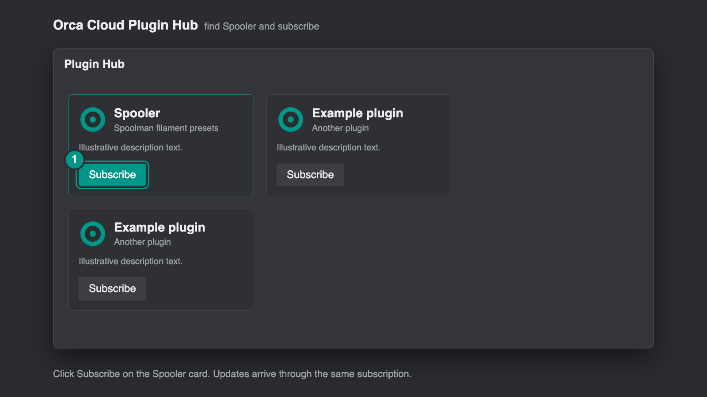
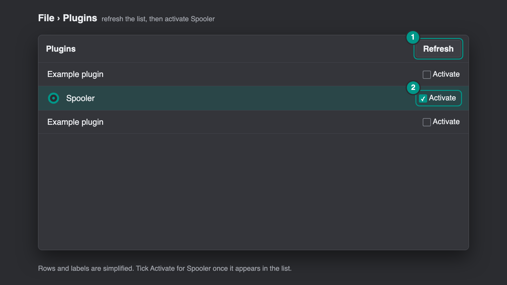
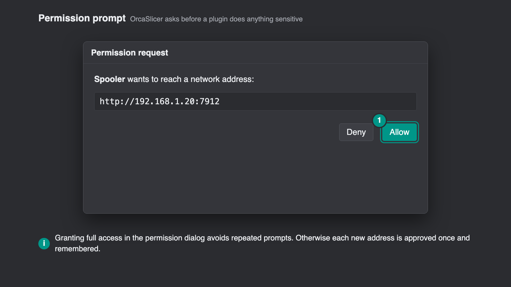
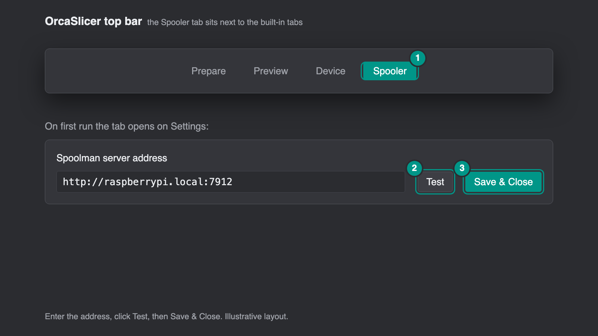

# Installing Spooler, step by step

The pictures are drawn illustrations, simplified, not screenshots. The setup guide in the fourth one
is the real one. Regenerate them with `python scripts/store_images/install_guide.py`.

## From Orca Cloud

1. Open [Spooler on Orca Cloud](https://cloud.orcaslicer.com/p/50c35dcbd6f3) and click **Subscribe**.
   Updates arrive the same way.

   

2. In OrcaSlicer open **Plugins** (Windows and Linux: the small ▾ arrow next to **File** at the top left of OrcaSlicer's window; macOS: **File > Plugins** in the menu bar at the top of the screen), click **Refresh**, then tick **Activate** for Spooler.

   

3. Allow the permissions. OrcaSlicer asks before a plugin does anything sensitive. Granting Spooler
   full access in the permission dialog avoids repeated prompts. Otherwise each new address it reads
   (Spoolman and each printer) is approved once and remembered.

   

4. Follow the setup guide. A **Spooler** tab appears in the top bar and opens a short guide on first
   run. Enter your Spoolman server address (for example `http://raspberrypi.local:7912`), click
   **Test**, and **Next** unlocks once the connection is confirmed.

   

## From a file

1. Download `spooler_any.whl` from the [latest release](https://github.com/bloodf/spooler/releases/latest).
   It is the same file on Windows, macOS and Linux.
2. In OrcaSlicer, open **Plugins** (as in step 2 above) **> Install local plugin** and pick the file. If you installed an older
   `spooler_any.py` by hand (in an `orca_plugins/spooler` folder), remove it first so the two don't clash.
3. Tick **Activate** for Spooler.

The [user guide](guide.md) continues from here.
