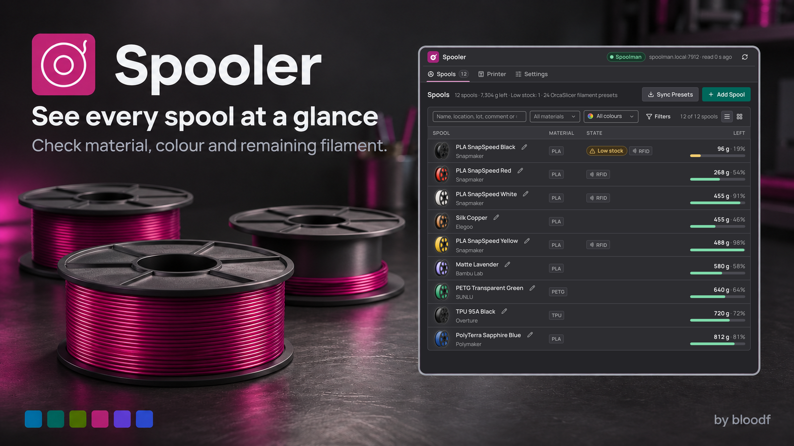
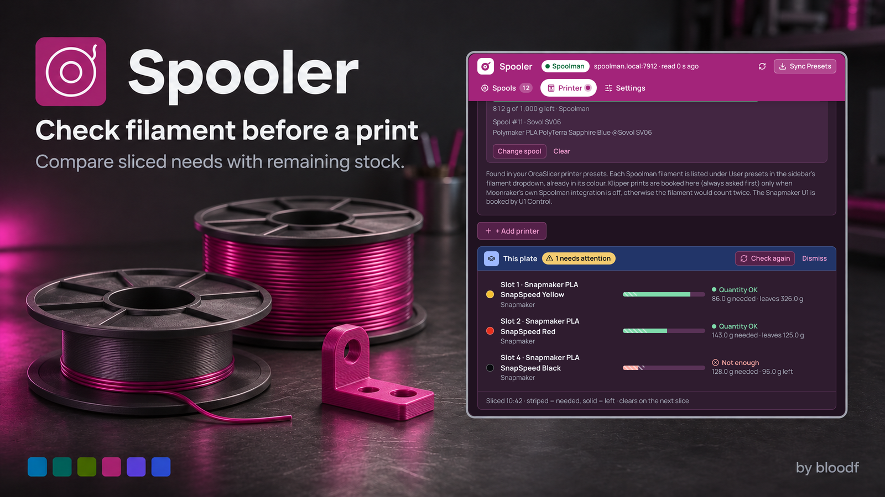
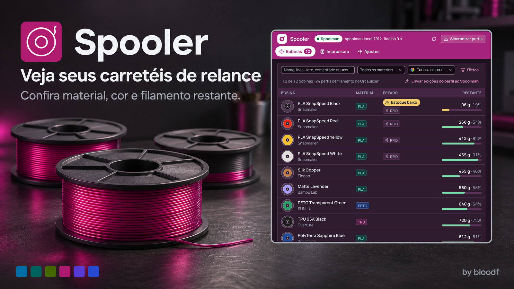
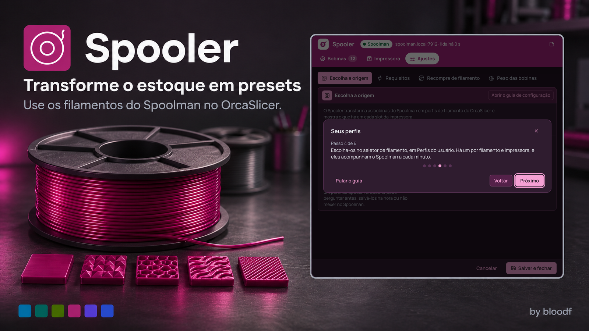
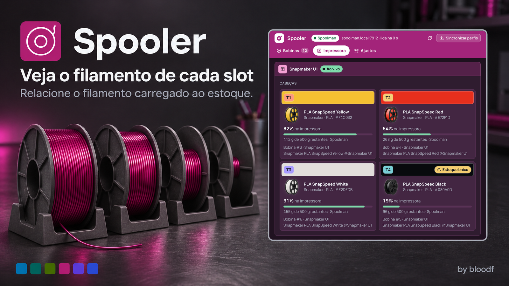
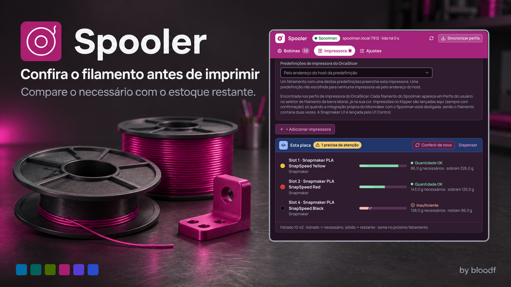

# Orca Cloud description

Listing text for Spooler on Orca Cloud, one block per language. Paste each block into the matching description field. Each block stays under 4000 characters, and the four images resolve once this branch is merged to main.

## English

```markdown
Your Spoolman stock inside OrcaSlicer, with what is left on each spool.

## What you need

- OrcaSlicer 2.5.0 or later
- A Spoolman server you can reach (or a Bambu Cloud account, read-only)
- Optional: a Klipper/Moonraker, Snapmaker U1, Anycubic or Bambu Lab printer on your network

## What it does

Lists every spool with material, colour, location and grams left.
Turns each filament in stock into an OrcaSlicer filament preset for each of your printers, in its colour.
Shows which spool sits in each toolhead, lane or AMS slot.
Compares what a plate needs with what is left after you slice.
Sends changes you make to a Spooler preset back to Spoolman.






## How to start

1. Subscribe here, then open File > Plugins in OrcaSlicer, click Refresh and tick Activate.
2. Open the Spooler tab, enter your Spoolman address (for example http://raspberrypi.local:7912) and click Test.
3. Click Save & finish. Your spools appear in the list.

## Privacy

No telemetry and no account. Spooler talks only to the servers you point it at: your Spoolman server, your printers on the local network, Bambu Cloud if you choose it, and GitHub to check for a new release. OrcaSlicer asks before it reaches a new address.

## Languages

English, Brazilian Portuguese, Spanish, German and Simplified Chinese, following OrcaSlicer's language.

## More plugins by bloodf

- [Organizer](https://cloud.orcaslicer.com/p/5bf381fd42d4): Arrange parts by their real outline and fill a plate with more copies.
- [Embedder](https://cloud.orcaslicer.com/p/58222d4f9e52): Magnet and NFC pockets, with the pause at the right layer.
- [Print Calculator](https://cloud.orcaslicer.com/p/521c07cf6de2): Price every plate: filament, energy, labour, fees and margin.
- [Kobra Control](https://cloud.orcaslicer.com/p/59c786285255): Run the Anycubic Kobra X from OrcaSlicer over your LAN.
- [U1 Control](https://cloud.orcaslicer.com/p/55b8c347d443): Run the Snapmaker U1 from OrcaSlicer: toolheads, camera, files.

Each plugin works on its own; installed together they share data where it helps.

## Source code

https://github.com/bloodf/spooler (GPL-3.0-only). Based on Spoolio by Dan J Moore. Not affiliated with Spoolman, OrcaSlicer, Snapmaker, Sovol, Anycubic or Bambu Lab.
```

## Português (Brasil)

```markdown
Seu estoque do Spoolman dentro do OrcaSlicer, com o que resta em cada bobina.

## O que você precisa

- OrcaSlicer 2.5.0 ou mais novo
- Um servidor Spoolman que você consiga acessar (ou uma conta Bambu Cloud, somente leitura)
- Opcional: uma impressora Klipper/Moonraker, Snapmaker U1, Anycubic ou Bambu Lab na sua rede

## O que faz

Lista cada bobina com material, cor, local e gramas restantes.
Transforma cada filamento em estoque em um perfil de filamento do OrcaSlicer para cada uma das suas impressoras, na cor dele.
Mostra qual bobina está em cada cabeça, lane ou slot do AMS.
Compara o que a mesa precisa com o que resta, depois de fatiar.
Envia ao Spoolman as mudanças que você faz num perfil do Spooler.






## Como começar

1. Assine aqui, depois abra File > Plugins no OrcaSlicer, clique em Refresh e marque Activate.
2. Abra a aba Spooler, digite o endereço do seu Spoolman (por exemplo http://raspberrypi.local:7912) e clique em Testar.
3. Clique em Salvar e concluir. Suas bobinas aparecem na lista.

## Privacidade

Sem telemetria e sem conta. O Spooler fala só com os servidores que você indicar: seu servidor Spoolman, suas impressoras na rede local, a Bambu Cloud se você escolher e o GitHub para saber se há versão nova. O OrcaSlicer pergunta antes de acessar um endereço novo.

## Idiomas

Inglês, português do Brasil, espanhol, alemão e chinês simplificado, seguindo o idioma do OrcaSlicer.

## Mais plugins do bloodf

- [Organizer](https://cloud.orcaslicer.com/p/5bf381fd42d4): Organize as peças pelo contorno real e encha a mesa com mais cópias.
- [Embedder](https://cloud.orcaslicer.com/p/58222d4f9e52): Bolsos para ímãs e NFC, com a pausa na camada certa.
- [Print Calculator](https://cloud.orcaslicer.com/p/521c07cf6de2): Preço de cada mesa: filamento, energia, mão de obra, taxas e margem.
- [Kobra Control](https://cloud.orcaslicer.com/p/59c786285255): Controle a Anycubic Kobra X pelo OrcaSlicer na sua rede.
- [U1 Control](https://cloud.orcaslicer.com/p/55b8c347d443): Controle a Snapmaker U1 pelo OrcaSlicer: cabeças, câmera, arquivos.

Cada plugin funciona sozinho; instalados juntos, compartilham dados onde ajuda.

## Código-fonte

https://github.com/bloodf/spooler (GPL-3.0-only). Baseado no Spoolio, de Dan J Moore. Sem afiliação com Spoolman, OrcaSlicer, Snapmaker, Sovol, Anycubic ou Bambu Lab.
```
