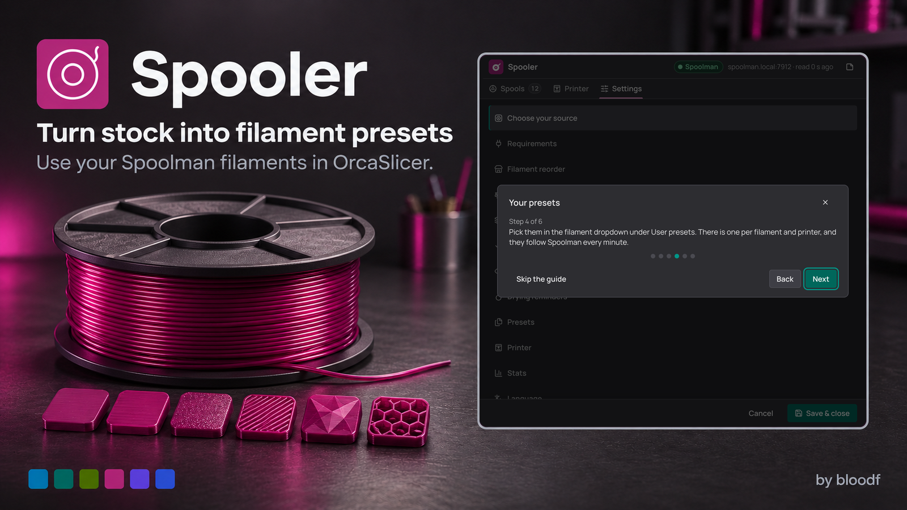
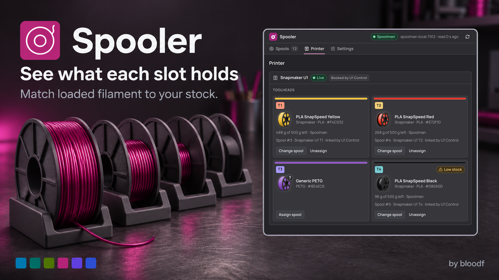

# Orca Cloud description

Listing text for Spooler on Orca Cloud (<https://cloud.orcaslicer.com/p/50c35dcbd6f3>). Paste the block into the English description. The listing is English only and stays well under Orca Cloud's 4000 characters; the full description is [README.md](../README.md). The four images resolve once this branch is merged to main.

```markdown
Your Spoolman stock inside OrcaSlicer, with what is left on each spool.

Full description: https://github.com/bloodf/spooler/blob/main/README.md

## What it does

- Lists every spool with material, colour, location and grams left, with search across all fields.
- Turns each filament in stock into an OrcaSlicer filament preset for each of your printers, in its colour.
- Shows which spool sits in each toolhead, lane, ACE or AMS slot, and what is printing now.
- Compares what a plate needs with what is left after you slice.
- Sends changes you make to a Spooler preset back to Spoolman.






## Install

1. Subscribe on this page.
2. In OrcaSlicer open Plugins, click Refresh and tick Activate. macOS: File > Plugins. Windows and Linux: the ▾ next to File > Plugins.
3. Open the Spooler tab, enter your Spoolman address, click Test, then Save & finish.

Needs OrcaSlicer 2.5.0 or later and a Spoolman server (or a Bambu Cloud account, read-only). Printers are optional: Klipper/Moonraker, Snapmaker U1, Anycubic and Bambu Lab in LAN mode, PrusaLink, OctoPrint.

## Privacy

No telemetry and no account. Spooler talks only to your Spoolman server, your printers on the local network, Bambu Cloud if you choose it, and GitHub to check for a new release.

More plugins by bloodf: [Organizer](https://cloud.orcaslicer.com/p/5bf381fd42d4) · [Embedder](https://cloud.orcaslicer.com/p/58222d4f9e52) · [Print Calculator](https://cloud.orcaslicer.com/p/521c07cf6de2) · [U1 Control](https://cloud.orcaslicer.com/p/55b8c347d443) · [Kobra Control](https://cloud.orcaslicer.com/p/59c786285255)

Source: https://github.com/bloodf/spooler (GPL-3.0-only). Based on Spoolio by Dan J Moore. Not affiliated with Spoolman, OrcaSlicer or any printer maker.
```
